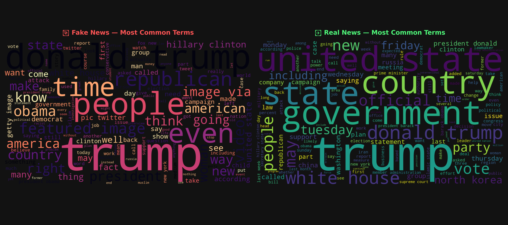
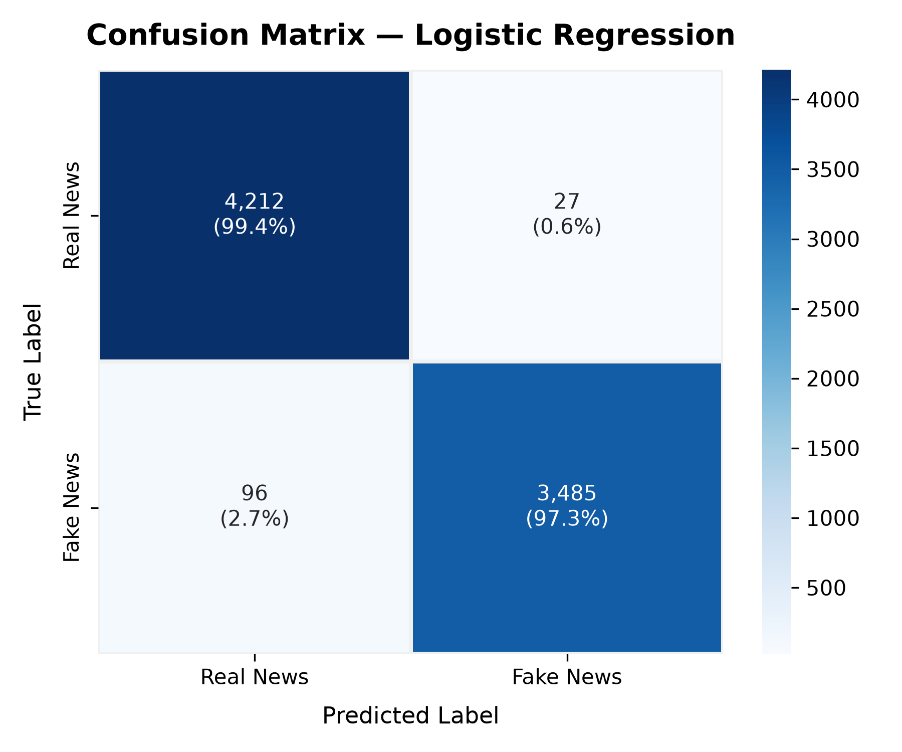
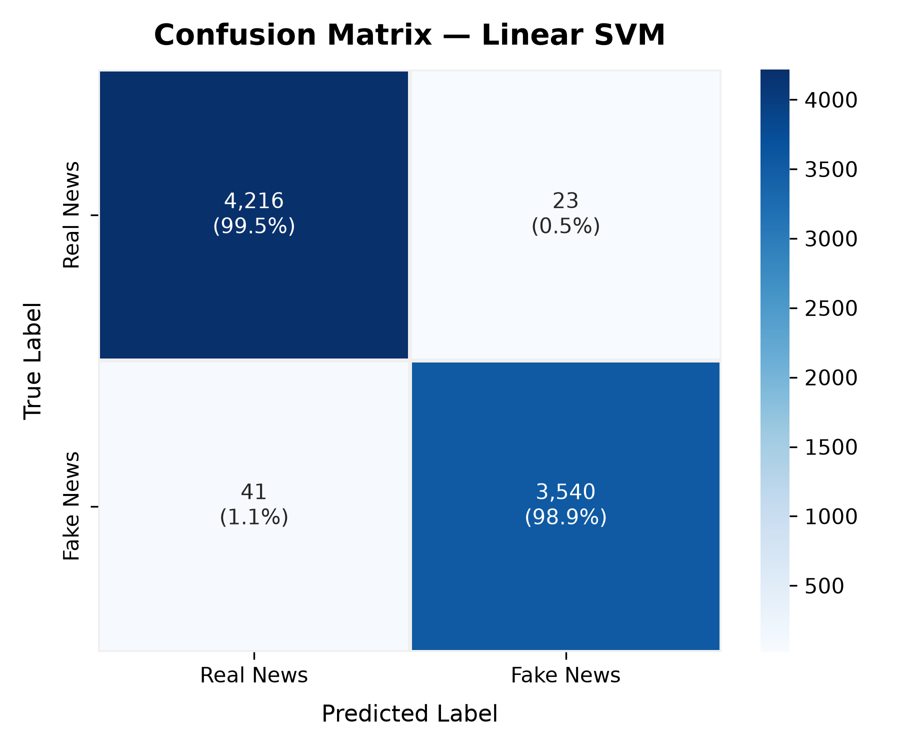

# 📰 Fake News Detection with Machine Learning

A complete, high-performance Fake News Detection system built with **Scikit-learn**, **NLTK**, and **TF-IDF Vectorization**. The project compares **Logistic Regression** and **Linear Support Vector Machines (LinearSVC)** to accurately classify news articles as **Real** or **Fake** based on their linguistic content, headline, and textual patterns.

---

## 📂 Project Structure

```
Fake-News-Detection/
├── config.json               # Hyperparameters, random seeds, paths, vectorizer settings
├── data_preprocess.py        # Loading, cleaning, stopword removal, lemmatization
├── train.py                  # TF-IDF vectorization, Logistic Regression & SVM training
├── utils.py                  # Evaluation metrics, confusion matrix & word cloud generation
├── inference.py              # Interactive CLI with preset news bank & custom input
├── main.py                   # Master entrypoint running the complete end-to-end pipeline
├── requirements.txt          # Python library dependencies
├── README.md                 # Project documentation
├── data/                     # Raw datasets (Fake.csv, True.csv)
├── models/                   # Serialized model weights & vectorizer
│   ├── tfidf_vectorizer.joblib
│   ├── logistic_regression.joblib
│   └── svm_model.joblib
└── Assets/                   # Visualizations & figures
    ├── wordclouds_comparison.png
    ├── wordcloud_fake.png
    ├── wordcloud_real.png
    ├── confusion_matrix_logistic_regression.png
    └── confusion_matrix_svm.png
```

---

## 🛠️ Setup & Installation

### Install Dependencies
```bash
pip install -r requirements.txt
```

---

## 🚀 Usage

### 1. Run Complete Pipeline (Preprocessing, Training & Evaluation)
```bash
python main.py
```
This script will:
1. Load `data/Fake.csv` and `data/True.csv` and display dataset statistics.
2. Generate word clouds comparing Fake vs. Real news in `Assets/`.
3. Preprocess and lemmatize article texts.
4. Fit TF-IDF vectorizer and train both Logistic Regression and SVM.
5. Save trained models in `models/` and confusion matrices in `Assets/`.

### 2. Run Interactive Inference CLI
```bash
python inference.py
```
Launches an interactive terminal application where you can:
- **Test curated articles** from real-world headlines across politics, science, and world news.
- **Enter or paste your own custom news article** for real-time classification.
- View **prediction confidence**, **probability breakdown**, and **key linguistic indicator words**.

---

## ⚙️ Configuration

All pipeline parameters can be customized in `config.json`:

| Parameter | Type | Description |
| :--- | :--- | :--- |
| `fake_path` | `str` | Path to `Fake.csv` |
| `true_path` | `str` | Path to `True.csv` |
| `models_dir` | `str` | Directory to save serialized models |
| `assets_dir` | `str` | Directory to save visualizations |
| `test_size` | `float` | Test split fraction (e.g., `0.2` for 80/20 split) |
| `random_state` | `int` | Reproducibility seed (`42`) |
| `vectorizer.max_features` | `int` | Maximum TF-IDF vocabulary size (`10000`) |
| `vectorizer.ngram_range` | `list` | Token n-gram range (`[1, 2]`) |
| `logistic_regression.C` | `float` | Inverse regularization strength (`1.0`) |
| `svm.C` | `float` | SVM regularization parameter (`1.0`) |

---

## 📊 Evaluation & Results

Both models were evaluated on a held-out test split of **7,820 articles** (20% of the corpus):

| Model | Accuracy | F1-Score | Precision | Recall | ROC-AUC | Training Time |
| :--- | :---: | :---: | :---: | :---: | :---: | :---: |
| **Logistic Regression** | **98.43%** | **98.27%** | 99.23% | 97.32% | 99.90% | < 1s |
| **Linear SVM (Calibrated)** | **99.18%** | **99.10%** | 99.35% | 98.86% | 99.96% | ~3s |

### Visualizations

#### 1. Word Clouds (Fake vs. Real News Terms)
Common terms and vocabulary distinct to fake versus real articles:

<p align="center">
  
</p>

#### 2. Confusion Matrices
Evaluation diagnostics on the test split:

<p align="center">
  
  
</p>

---

## 📚 Dataset Details

This project uses the [Kaggle Fake and Real News Dataset](https://www.kaggle.com/datasets/clmentbisaillon/fake-and-real-news-dataset):
- **Real News (`True.csv`)**: Verified news articles from Reuters covering world news and domestic politics.
- **Fake News (`Fake.csv`)**: Unverified articles, conspiratorial claims, and fabricated stories collected from flagged websites.